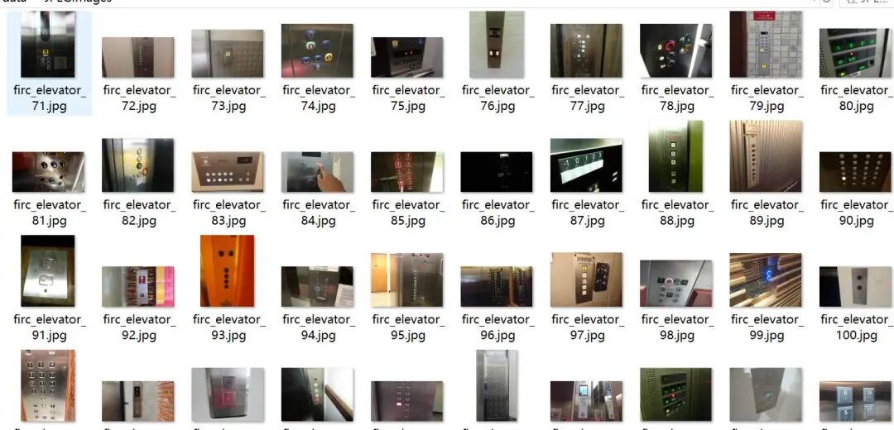
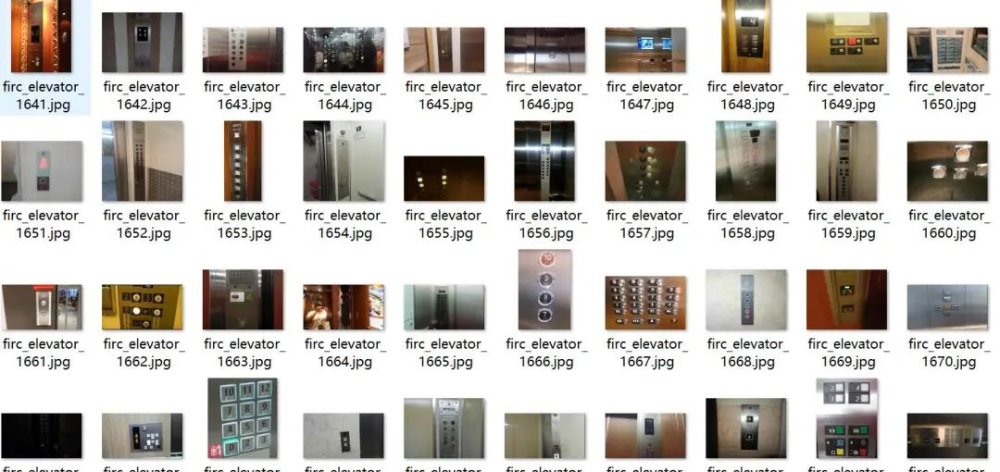
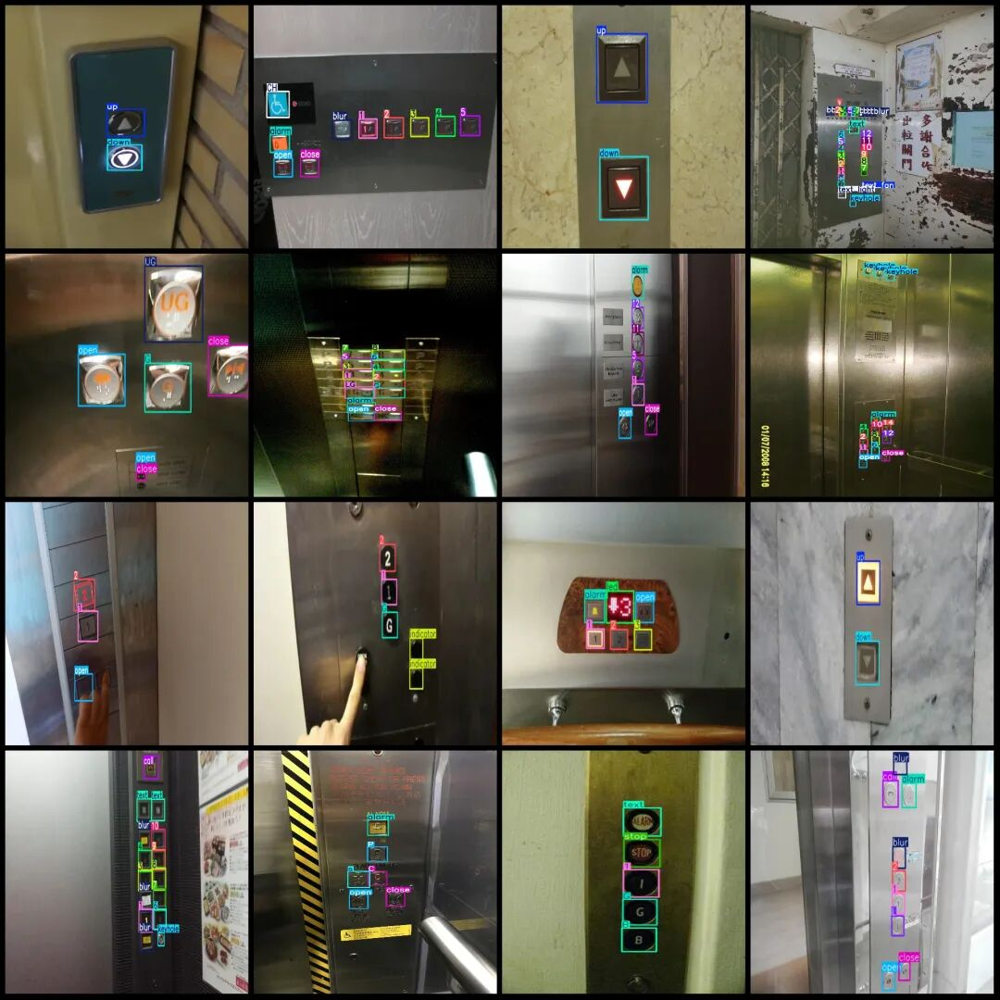
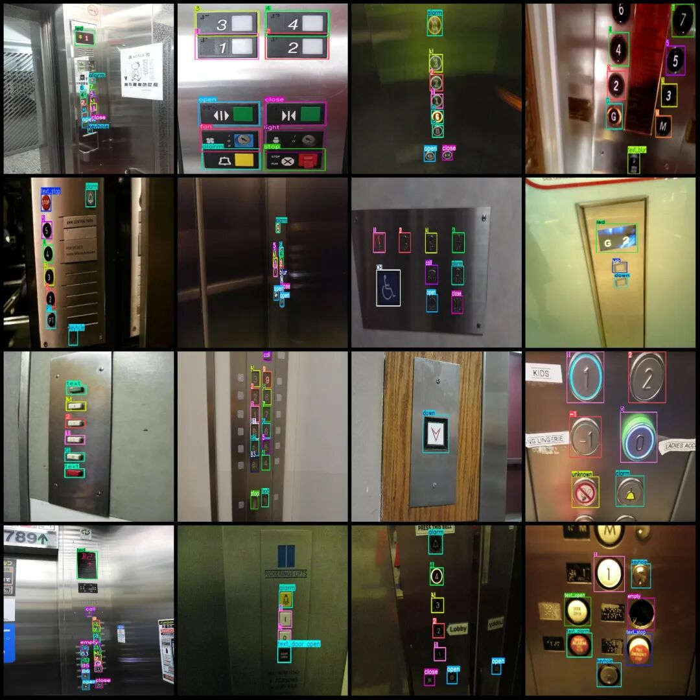

# Elevator Button Recognition and Detection Dataset VOC+YOLO format with 2019 categories, 368 classes

Dataset format: Pascal VOC format + YOLO format (txt file without split path, only contains jpg images and corresponding VOC format xml files and yolo format txt files)

Number of images (number of jpg files): 2019

Number of annotations (number of xml files): 2019

Number of annotations (number of txt files): 2019

Label count: 368

Label category names(NoteyoloThe format category order does not correspond to this, but instead...labelsFolderclasses.txtPrecise):["0","1","1A","1B","1E","1F","1R","1U","2","2A","2B","2M","2R","2U","3","3A","3B","3F","3M","3N","3R","3S","4","4A","4B","5","5A","5B","5P","6","6M","7","8","8A","9","9M","10","11","12","12A","12B","12M","13","13A","14","15","16","17","18","18A","19","20","21","22","23","23A","24","25","26","27","27A","28","29","30","31","32","33","33A","34","35","36","37","38","39","40","41","42","43","44","45","46","47","48","49","50","51","52","53","54","55","56","57","58","59","60","61","62","63","65","66","67","68","69","114","117","118","119","-","-1","-1M","-2","-3","-4","-5","-7","A","AA","AL","ALT","B","B1","B2","B3","B4","B5","B6","B7","BC","BF","BR","C","CH","CL","CP","D","D0","DC","DH","DHB","DHF","DHR","DN","DO","DOR","E","EG","EN","EX","F","F1","FB","FF","G","G1","G2","GA","GF","GG","GR","H","HC","I","ID","IR","IU","J","K","K1","L","L1","L2","L3","L4","L5","L6","L7","LB","LG","LG1","LG2","LGA","LL","LL2","LM","LP","LR","LS","M","M2","MC","MG","MZ","NS","O","P","P1","P1A","P1B","P2","P2A","P2B","P3","P3A","P3B","P4","P4A","P5","P5A","P6","P6A","P7","P7A","P8","P8A","P9","P9A","P10","P11","P12","P15","P25","P35","P45","PA","PB","PG","PH","PH1","PH2","PL","PL4","PT","R","REF","RF","RL","RR","RS","S","S1","S2","SB","SF","SL","SPA","ST","T","TF","TOR","U","U1","U2","UB","UG","UL","UM","UP","UT","V","alarm","blur","bt_keyhole","bt_switch","call","close","down","empty","fan","fire","hat","indicator","key","keyhole","led","light","open","s","s1","s2","s3","sE","sG","sGR","sL","sLL","sP","sP1","sPS","speaker","stop","switch","text","text_1-5","text_2-5","text_3-5","text_30-90","text_340m","text_345m","text_ALARM","text_CALL","text_CALL CANCEL","text_CLOSE","text_CLOSE DOOR","text_DOOR CLOSE","text_DOOR OPEN","text_DOWN","text_FAN","text_FULL","text_GROUND","text_HOLD","text_INUSE","text_LL1R","text_LL2R","text_MEZZ","text_Mez","text_OPEN","text_OPEN DOOR","text_PASS","text_STOP","text_alarm","text_alarm bell","text_attendant","text_bell","text_blur","text_bridge","text_bypass","text_call bell","text_call cancel","text_call lift","text_car here","text_close","text_close door","text_delay","text_door close","text_door ext","text_door open","text_doordelay","text_emege call","text_emerg","text_emerg bell","text_emerg call","text_emergency","text_fan","text_ground","text_help","text_hold","text_homing","text_in use","text_intercom","text_light","text_lobby","text_nostop","text_oepn","text_open","text_open door","text_open hold","text_overload","text_overloaded","text_overweight","text_pass","text_plaza","text_push","text_start","text_stop","text_street","unknown","up","updown"]

Number of boxes labeled in each category:

0 Frames = 174

1 Frames = 1140

1A Frame count = 2

1B Frames = 1

1E Frames = 3

1F Frames = 1

1R Frames = 3

1U Frames = 2

2 Frames = 1200

2A Frames = 2

2B Frame Count = 1

2M Frames = 3

2R Frames = 2

2U Frames = 2

3 Frames = 1090

3A Frames = 11

3B Frames = 1

3F Frames = 2

3M Frames = 2

3N frame count = 1

3R box count = 1

3S frame count = 1

4 Frames = 894

4A Frames = 3

4B Frames = 3

5 Frames = 798

5A Frame count = 1

5B Frames = 1

5P Frames = 2

6 Frames = 665

6M Frames = 1

7 Frames = 593

8 Frames = 565

8A Frame count = 1

9 Frames = 501

9M Frames = 1

10 frames = 395

11 Frames = 352

12 Frames = 323

12A Frames = 6

12B Frame Count = 1

12M Frames = 1

13 Frames = 169

13A Frame count = 1

14 Frames = 227

15 Frames = 227

16 Frames = 220

17 Frames = 202

18 Frames = 209

18A Frame count = 1

19 Frames = 190

20 frames = 179

21 Frames = 152

22 Frames = 150

23 Frames = 132

23A Frames = 1

24 Frames = 101

25 Frames = 113

26 Frames = 100

27 Frames = 86

27A Frames = 1

28 Frames = 79

29 Frames = 73

30 frames = 63

31 Frames = 61

32 Frames = 57

33 Frames = 55

33A Frame count = 1

34 Frames = 40

35 Frames = 46

36 frames = 40

37 Frames = 34

38 Frames = 31

39 Frames = 31

40 frames = 29

41 Frames = 22

42 Frames = 21

43 Frames = 19

44 Frames = 11

45 Frames = 17

46 Frames = 19

47 Frames = 14

48 Frames = 11

49 Frames = 7

50 frames = 8

51 Frames = 3

52 Frames = 6

53 Frames = 6

54 Frames = 1

55 Frames = 4

56 Frames = 3

57 Frames = 4

58 Frames = 3

59 Frames = 4

60 frames = 3

61 Frames = 3

62 Frames = 2

63 Frames = 3

65 Frames = 2

66 Frames = 1

67 Frames = 1

68 Frames = 1

69 Frames = 1

114 Frames = 1

117 Frames = 1

118 Frames = 1

119 Frames = 1

- Frames = 51

-1 Frames = 45

-1M Frames = 2

-2 Frames = 13

-3 Frames = 5

-4 Frames = 3

-5 Frames = 1

-7 Frames = 1

A box count = 9

AA Frames = 1

AL Frame Count = 1

ALT Frames = 1

B box count = 187

B1 Frames = 150

B2 Frames = 81

B3 Frames = 40

B4 Frame Count = 16

B5 Frames = 6

B6 Frames = 4

B7 Frame Count = 1

BC Frames = 3

BF Frame Count = 1

BR Frames = 4

C Frames = 17

CH Frames = 120

CL Frames = 2

CP Frames = 4

D Frames = 23

D0 Frames = 1

DC Frame Count = 12

DH Frames = 2

DHB Frame Count = 1

DHF Frame Count = 1

DHR Frame Count = 1

DN Frame Count = 1

DO Frames = 19

DOR Frame Count = 1

E Frames = 23

EG Frame Count = 1

EN Frame Count = 1

EX Frames = 1

F Frames = 3

F1 Frames = 2

FB Frames = 1

FF Frames = 1

G Frames = 445

G1 Frame Count = 1

G2 Frame Count = 1

GA Frames = 1

GF Frame Count = 9

GG Frame Count = 1

GR Frames = 1

H Frames = 1

HC Frames = 1

I Frames = 1

ID Frames = 1

IR Frames = 2

IU Frame Count = 1

J Frames = 1

K Frames = 14

K1 Frame Count = 1

L Frames = 59

L1 Frame Count = 12

L2 Frames = 9

L3 Frame Count = 7

L4 Frame Count = 3

L5 Frames = 3

L6 Frame Count = 2

L7 Frames = 1

LB Frames = 5

LG Frames = 62

LG1 Frame Count = 7

LG2 Frame Count = 3

LGA Frame Count = 1

LL Frames = 5

LL2 Frame Count = 1

LM Frames = 1

LP Frames = 1

LR Frames = 2

LS Frames = 1

M Frames = 78

M2 Frame Count = 3

MC Frames = 1

MG Frame Count = 1

MZ Frame Count = 4

NS Frames = 9

O Frames = 1

P box count = 21

P1 Frames = 26

P1A Frame Count = 1

P1B Frame Count = 1

P2 Frames = 24

P2A Frame Count = 2

P2B Frame Count = 1

P3 Frames = 14

P3A Frame Count = 2

P3B Frame Count = 1

P4 Frames = 4

P4A Frame Count = 2

P5 Frames = 3

P5A Frame Count = 1

P6 Frames = 3

P6A Frame Count = 1

P7 Frames = 1

P7A Frame count = 1

P8 Frames = 2

P8A Frame count = 1

P9 Frames = 1

P9A Frame count = 1

P10 Frames = 1

P11 Frame count = 1

P12 Frame Count = 1

P15 Frames = 1

P25 Frame Count = 1

P35 Frames = 1

P45 Frame Count = 1

PA Frames = 1

PB Frames = 3

PG Frames = 1

PH Frames = 5

PH1 Frame Count = 1

PH2 Frame Count = 1

PL Frames = 4

PL4 Frame Count = 1

PT Frames = 3

R Frames = 38

REF Frame Count = 1

RF Frames = 3

RL Frames = 1

RR Frames = 1

RS Frames = 1

S Frames = 10

S1 Frames = 1

S2 Frames = 1

SB Frames = 5

SF Frames = 1

SL Frames = 4

SPA Frames = 1

ST Frame Count = 1

T Frames = 3

TF Frames = 1

TOR Frames = 1

U Frames = 21

U1 Frame Count = 4

U2 Frames = 1

UB Frames = 3

UG Frame Count = 29

UL Frame Count = 2

UM Frames = 1

UP Frames = 3

UT Frames = 1

V Frames = 6

Alarm Frame Count = 842

Blur Frames = 648

bt_keyhole frame count = 83

bt_switch box count = 14

Call Frame Count = 239

Close Frame Count = 971

Down Frame Count = 335

Empty box count = 1159

Fan frame count = 20

Fire Frame Count = 2

Number of hats = 9

Number of indicators = 183

Key Frame Count = 6

Keyhole frame count = 743

Number of LEDs = 475

Light Frame Count = 7

Number of open boxes = 1072

S Frames = 48

s1 Frames = 77

S2 Frames = 3

s3 Frame Count = 1

sE Frame Count = 1

sG Frame Count = 30

sGR Frame Count = 1

SL Frames = 20

sLL Frame Count = 1

SP Frames = 2

sP1 Frame Count = 1

sPS Frame Count = 1

Speaker frame count = 52

Stop Frames = 88

Switch frame count = 85

Text box count = 221

text_1-5 Frames = 1

text_2-5 Frames = 1

text_3-5 Frames = 1

text_30-90 Frames = 1

text_340m Frames = 1

text_345m Frames = 1

text_ALARM Frames = 5

text_CALL Frames = 10

text_CALL CANCEL Frames = 1

text_CLOSE Frames = 1

text_CLOSE DOOR Frames = 2

text_DOOR CLOSE Frames = 1

text_DOOR OPEN Frames = 1

text_DOWN Frames = 1

Text_FAN Frames = 3

text_FULL Frames = 1

text_GROUND Frames = 1

text_HOLD Frames = 2

text_INUSE frame count = 1

text_LL1R box count = 1

text_LL2R box count = 1

text_MEZZ box count = 1

text_Mez Frame Count = 1

text_OPEN Frames = 2

text_OPEN DOOR Frames = 1

text_PASS Frames = 1

text_STOP Frames = 1

text_alarm Frames = 48

text_alarm bell Frames = 1

text_attendant frame count = 3

text_bell Frames = 1

text_blur Frames = 143

text_bridge Frames = 2

text_bypass Frames = 1

text_call bell Frames = 2

text_call cancel box = 1

text_call lift Frames = 1

text_car here Frames = 1

text_close Frames = 37

text_close door Frames = 4

text_delay Frames = 1

text_door close Frames = 3

text_door ext Frame Count = 1

text_door open Frames = 11

text_doordelay Frames = 1

Text: Emege call box number = 1

text_emerg Frames = 1

text_emerg bell Frame count = 1

text_emerg call Frame count = 1

text_emergency Frames = 5

text_fan Frames = 3

text_ground Frames = 2

text_help Frames = 3

text_hold Frames = 2

text_homing Frames = 1

Output: 1

text_intercom Frame Count = 1

text_light Frames = 6

text_lobby box count = 1

text_nostop Frames = 2

text_open Frames = 1

text_open Frames = 50

text_open door Frames = 7

text_open hold frame count = 2

text_overload Frames = 4

text_overloaded Frames = 1

text_overweight Frames = 2

text_pass Frames = 1

text_plaza Frame Count = 2

text_push Frames = 1

text_start Frames = 1

text_stop Frames = 41

text_street Frames = 1

Unknown number of frames = 584

Up Frames = 393

Updown Frames = 3

Total frames: 22843

Image resolution: Multi-resolution images, such as 1024x576, 1920x1920, etc.

Using labelImg:

Annotation rules: Draw a rectangle around the category.

Important Notice: No

Special : This dataset does not guarantee the accuracy of the trained models or weight files.

Image Preview:

Annotation example:

## Payment

Here is a pay link on Stripe ( https://buy.stripe.com/3cs8yP7sY87d0vu9AB ). Please contact me lonlonago@foxmail.com after funding $89, and I will send you a complete data files , thank you!

